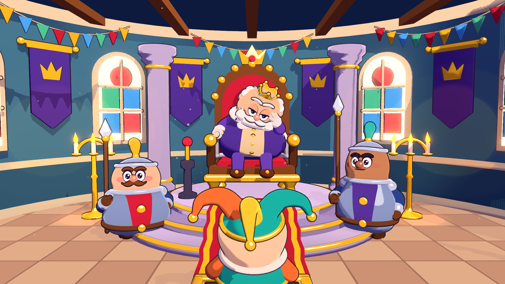

# Not Amused

*Make the king laugh. With your voice.* You are a jester on a trapdoor, with one minute and a microphone. The king hears
you, answers, and is not amused. Fill his laughter meter and you are pardoned; run out of time and the trapdoor opens.

**[Play it in your browser](https://lokutor.com/games/not-amused/)**, with no download and no account.



The king is a voice agent of [Lokutor](https://lokutor.com), in a [Godot](https://godotengine.org) game made with the
[Lokutor Godot SDK](https://docs.lokutor.com/sdks/godot/introduction). How it is put together, and why:
[Sample game: Not Amused](https://docs.lokutor.com/guides/sample-game-not-amused).

## Run it

You need **Godot 4.4** or newer (it is made with 4.7), a microphone, and a **Lokutor API key** from
[app.lokutor.com](https://app.lokutor.com) (new accounts get free credit).

```bash
export LOKUTOR_API_KEY=...            # PowerShell: $env:LOKUTOR_API_KEY = "..."
godot --path .                        # or open project.godot in the editor and press F5
```

The key is read from the environment so that it is never in the project. **Do not put a key in a build you give to
anyone**: anything in a build can be read. A shipped game asks its own server for a short-lived ticket
([Shipping](https://docs.lokutor.com/sdks/godot/introduction#shipping)), and a web build does the same
([Games in a web browser](https://docs.lokutor.com/guides/game-web)).

## Playing

SPACE starts and starts again. The title screen shows the microphone and what it hears; M changes to the next one, and it
is remembered. F (or F11) is full screen; V tries another voice for the king. L changes the language: the nine that
Lokutor both hears and speaks, in `game/words.gd`, and what the king is told, in `game/prompts.gd`.

Interrupt him and he gets angry: it costs laughter, and the third time he may pull the lever. Pause in the middle of a joke
and he waits ("And?"); going on in his first second and a half is not interrupting him. With speakers he would
interrupt himself, so the game listens to his greeting through the microphone (`game/leak.gd`) and closes it while he talks
if it hears him there. H says it by hand, "yes" with headphones and "no" without; it is remembered.

## Files

| File | |
| :--- | :--- |
| `game/game.gd` | The king (`LokutorAgent`), his written lines and the guards (`LokutorVoice`), the meter, the clock, the rules |
| `game/prompts.gd`, `game/words.gd` | What the king is told, in nine languages; every word on screen |
| `game/stage.gd`, `game/throne_room.gd` | The cast in their places, the camera's shots; the set, light and dust |
| `game/hud.gd` | Bubbles, meter, clock, words, the card at the end |
| `game/leak.gd` | Headphones or speakers: finds out by listening for the king's voice in the microphone |
| `game/phone.gd`, `phone.tscn` | The game on a phone: a tap instead of the space bar, buttons instead of keys |
| `game/demo.gd` | Plays by itself from a script, through the microphone path |
| `game/script.json`, `game/script_lever.json` | A round that is won; a very short one that is not |
| `game/qa_shots.gd` | Stills of every shot |
| `assets/` | The characters (`.glb`, with their visemes and expressions), the props and the sounds the game loads |
| `art/` | Their sources, in Blender. They were built by Lokutor's own asset pipeline, which is not part of this repository |
| `addons/lokutor/` | The [Lokutor Godot SDK](https://github.com/lokutor-ai/lokutor-sdk) |
| `addons/toonkit/` | The cel-shaded look, the characters' faces and their life (blinks, moods, springs), shared by Lokutor's sample games |

Arguments, after `--`: `lang=<code>`, `headphones`, `speakers`, `mic=<part of its name>`, `king=<voice>`, `fullscreen`,
`demo=<script>` (plays by itself), `record=<folder>` (keeps the frames and the sound), `dev=<port>` (a development server
on this computer instead of the API).

```bash
godot --path . -- lang=es headphones                   # in Spanish, and you may talk over him
```

## License

[MIT](LICENSE), the code and the art. Made by [Lokutor](https://lokutor.com).
